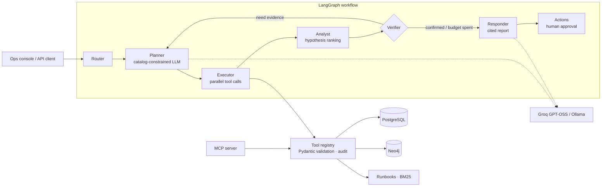

# Agentic RCA Platform

[](https://github.com/raj75114043-design/agentic-rca-platform/actions/workflows/ci.yml)
[](https://gitlab.com/raj75114043/agentic-rca-platform)
[](https://raj-agentic-rca-platform.streamlit.app)


Multi-agent root-cause analysis for telecom 5G rollout and network operations. An operations manager asks
*"Why is SITE-0228 delayed?"*; a team of LangGraph agents plans tool calls, gathers evidence from an operational
database and a knowledge graph, ranks hypotheses, loops until the cause is confirmed, writes a cited report and
proposes an action that a human must approve.

> **Live console:** https://raj-agentic-rca-platform.streamlit.app — all data is synthetic.

---

## The problem

In a network rollout, a delayed or failed site can be caused by a late vendor delivery, a pending municipal permit,
an unavailable crew, a regional grid outage, a fibre cut or a defective hardware batch. The evidence is spread
across ERP purchase orders, project schedules, permit trackers, crew rosters and NOC incidents. Engineers spend
hours joining these by hand, and generic chatbots answer confidently without evidence.

## What the platform does

| Capability | How |
|---|---|
| Multi-step investigation | LangGraph workflow: Router → Planner → Executor → Analyst → Verifier ⟲ → Responder → Actions |
| Evidence, not guesses | Every tool returns evidence records with stable IDs; the report must cite them |
| Hallucination guard | LLM reports whose citations are not in the collected evidence are rejected and replaced with a deterministic report |
| Bounded autonomy | Planner restricted to a validated tool catalog; iteration budget; duplicate-call suppression |
| Human in the loop | Escalations, batch quarantines, permit escalations and generator dispatch need explicit approval |
| Two data stores | PostgreSQL for operational records, Neo4j for multi-hop dependencies (SQLite and NetworkX in lite mode) |
| Tool interoperability | The same tools are exposed through an MCP server for external agents |
| Free LLMs | Groq free tier (GPT-OSS 120B) or local Ollama; runs fully deterministic without a key |
| Production basics | API keys, request IDs, JSON logs, Prometheus metrics, persisted run traces, Docker, CI |
| Measured quality | Labelled evaluation with a CI quality gate |

## Architecture



### Example: an investigation that needs three rounds

```
router    intent=site_rca site=SITE-0228
planner   5 steps: get_site, get_site_activities, get_incidents, get_permits, graph_dependencies
executor  5 calls, 0 failed, 2 evidence items
analyst   top=VENDOR_DELAY (0.45), 1 next check
verifier  need more evidence: get_purchase_orders
planner   1 step: get_purchase_orders
executor  1 call, 3 evidence items
analyst   top=VENDOR_DELAY (0.90), 1 next check
verifier  need more evidence: get_vendor_scorecard
planner   1 step: get_vendor_scorecard
analyst   top=VENDOR_DELAY (0.95)
verifier  confirmed VENDOR_DELAY
responder report with 6 verified citations
actions   ESCALATE_VENDOR awaiting human approval
```

> **Root cause** (HIGH confidence): Alpha Infra Supplies has not delivered Baseband unit (PO-001824), 18 days overdue.
> - INTEGRATION activity ACT-01368 is IN_PROGRESS, 47 days overdue, blocked: Awaiting material `[activity:ACT-01368]`
> - PO PO-001824 for Baseband unit from Alpha Infra Supplies (VEN-001) is OVERDUE by 18 days `[po:PO-001824]`
> - Alpha Infra Supplies on-time rate 72%, 3 open overdue orders `[vendor:VEN-001]`
>
> **Recommended actions:** escalate to the vendor account manager; request expedited or partial shipment `[runbook:RB-001#Resolution]`

## Evaluation

`python -m rca.eval.run --gate` runs the full workflow on every labelled faulty site plus healthy sites (where the
correct answer is *no root cause*) and fails CI if a metric breaches its threshold.

| Metric | Result (deterministic mode) | Gate |
|---|---|---|
| Root-cause accuracy | 100% (79/79) | ≥ 90% |
| Key-entity accuracy (vendor, permit, crew, region, batch) | 100% | ≥ 85% |
| False-alarm rate on healthy sites | 0% | ≤ 10% |
| Answers with only valid citations | 100% | ≥ 98% |
| Average agent iterations | 1.66 | — |
| Latency p50 / p95 (lite mode, no LLM) | 11 ms / 25 ms | — |

**Read these numbers honestly:** the dataset is synthetic and the causes were injected by the same team that wrote
the hypothesis rules, so this measures that the workflow, tools and guards behave correctly — not real-world accuracy.
With an LLM enabled, routing, planning and the report wording come from the model; the citation guard and the
deterministic ranking keep the measured accuracy stable. See [docs/evaluation.md](docs/evaluation.md).

## Quick start

**Lite mode (SQLite + NetworkX, no Docker):**

```bash
pip install -r requirements-dev.txt
make test eval              # 24 tests (+1 Neo4j integration) + quality gate
make console                # http://localhost:8501
make api                    # http://localhost:8000/docs
```

**Full stack (PostgreSQL + Neo4j + API + console):**

```bash
cp .env.example .env        # optionally set GROQ_API_KEY
docker compose up --build   # console :8501, API :8000, Neo4j browser :7474
docker compose --profile observability up -d prometheus   # metrics :9090
```

**Free LLM options**

| Option | Setup |
|---|---|
| Groq free tier | Create a key at console.groq.com, set `GROQ_API_KEY` (model `openai/gpt-oss-120b`) |
| Ollama (local) | `ollama pull llama3.1:8b`, set `LLM_PROVIDER=ollama` |
| None | Default without a key — deterministic planning and templated reports |

**API**

```bash
curl -s -X POST localhost:8000/v1/rca -H "X-API-Key: dev-key" -H "Content-Type: application/json" \
     -d '{"question": "Why is SITE-0228 delayed?"}' | jq '.root_cause, .confidence, .actions'
curl -s -X POST localhost:8000/v1/actions/<id>/decision -H "X-API-Key: dev-key" \
     -H "Content-Type: application/json" -d '{"approve": true, "user": "ops.lead"}'
```

**MCP:** `python -m rca.mcp_server` exposes the tools over stdio to any MCP client.

## Repository layout

```
rca/
  agents/graph.py      LangGraph workflow (router, planner, executor, analyst, verifier, responder, actions)
  analysis.py          evidence-based hypothesis ranking and next-check proposals
  tools.py             validated, audited tool registry with evidence records
  stores/sql.py        PostgreSQL/SQLite repository, run traces, HITL actions
  stores/graph.py      Neo4j and NetworkX graph backends behind one interface
  llm.py               Groq / Ollama / OpenAI-compatible provider with fallback
  api.py               FastAPI service (auth, metrics, request IDs)
  mcp_server.py        MCP server over the same tools
  eval/run.py          labelled evaluation and quality gate
  data/generator.py    synthetic rollout and operations data with injected causes
  data/runbooks/       operational runbooks used for recommended actions
streamlit_app.py       operations console
docs/                  architecture, ADRs, on-call runbook, evaluation notes
```

## Design decisions

- [ADR-0001](docs/adr/0001-langgraph-explicit-workflow.md) — explicit LangGraph state machine instead of a free-running agent
- [ADR-0002](docs/adr/0002-relational-plus-graph.md) — PostgreSQL for records, Neo4j for dependencies
- [ADR-0003](docs/adr/0003-llm-optional-with-guards.md) — the LLM is optional and never the source of facts

## Limitations and roadmap

- Data is synthetic; connectors for a real ERP, permit system and NOC would replace the generator.
- Hypothesis rules cover six cause types; new causes need a rule and evaluation cases.
- Roadmap: streaming responses (SSE), OpenTelemetry traces, role-based approvals, LLM-as-judge for report quality.

## Licence

MIT
